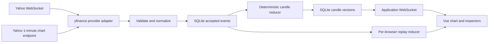

# Assignment 4.1 design and data pipeline

This localhost application records Yahoo Finance observations, builds one-minute candles, and replays the recorded availability sequence. It has no trading, strategy, order, account, or AI features. The default instrument is **BHP.AX**, an ASX equity quoted in AUD, with volume measured in shares. The captured source was active but approximately 20 minutes delayed. Receiving delayed messages is not evidence of fresh prices; the interface keeps source age visible.

## File responsibilities

| File | Responsibility |
| --- | --- |
| `backend/config.py` | Validated startup symbol and SQLite path. One symbol per backend process; fixed 60-second interval. |
| `backend/provider.py` | The single application-owned `yfinance.AsyncWebSocket`, valid-message watchdog, bounded retries, cleanup, and separate Yahoo minute-bar reconciliation. |
| `backend/market.py` | Validation, normalization, deterministic event-time candle reduction, corrections, interval completion, and coverage/provenance fields. No networking or wall-clock reads. |
| `backend/store.py` | SQLite schema initialization, accepted-event identity/deduplication, append-only revisions, atomic event/candle-version writes, and latest-state retrieval. |
| `backend/service.py` | Serialized ingestion, capture clock events, source status, persist-before-publish, and bounded per-browser queues. |
| `backend/replay.py` | A private reducer and frozen recording per browser. Replay controls and timing never write to capture storage. |
| `backend/main.py` | FastAPI lifespan, bounded retrieval routes, application WebSockets, and induced upstream interruption/resume. |
| `frontend/src/App.vue` | Live/replay state, socket lifecycle, source-age clock, accessible inspectors/table, and controls. |
| `frontend/src/MarketChart.vue` | One Lightweight Charts instance with candlestick and volume panes, incremental updates, older-candle corrections, resize handling, and cleanup. |
| `frontend/src/tokens.css`, `frontend/src/style.css` | Recorded design tokens and responsive financial-terminal layout. |
| `frontend/vite.config.js` | Local frontend on `127.0.0.1:5173`; `/api` and `/ws` proxy to FastAPI on `127.0.0.1:8000`. |

## Live path and boundaries

Ingestion is serialized. An accepted event and its resulting candle versions are committed in one SQLite transaction before the service publishes the saved update. Published events include the internal `id`; candles include `last_event_id`, `last_quote_event_id`, and `volume_event_id` so source, receipt, database, and display can be traced. These are application identifiers, not Yahoo trade IDs.

The provider belongs to application startup, not a browser connection. Opening more browser tabs does not start more source listeners. The pinned yfinance1.8 compatibility wrapper `FiniteSocket` turns normal iterator exhaustion into a connection error (avoiding a library busy loop), and errors propagate with `yf.config.debug.hide_exceptions=False`. Listener cleanup is bounded as well as socket closure. A listener attempt has finite subscribe/quiet-source timeouts; five attempts use backoff capped at 16 seconds. Exhaustion remains visibly unavailable until an explicit resume. Shutdown cancels source/history/clock tasks and closes sockets and SQLite.

`/ws/live` registers its bounded queue and obtains the saved snapshot without yielding between those operations. The snapshot followed by queued updates prevents an HTTP-history/stream handoff gap. A slow browser receives a resync/close and reconnects for a fresh saved snapshot; capture does not wait for the browser. The frontend merges candles by interval key and protects mode changes with a connection-generation token so an old live response cannot enter a replay view.

| Interface | Meaning and bounds |
| --- | --- |
| `GET /api/health` | Backend/SQLite readiness, with upstream state reported separately. |
| `GET /api/status` | Source status, maximum accepted source timestamp, separate receipt time, saved counts, and errors. |
| `GET /api/history?limit=360` | Latest saved candles in time order; limit 1–600. |
| `GET /api/observations?limit=20` | Recent saved events; limit 1–100. |
| `GET /api/replay` | Recording bounds and replay availability. |
| `WS /ws/live` | Saved snapshot, committed event/candle updates, and status. |
| `WS /ws/replay` | Frozen recording; `start`, `pause`, `resume`, and `restart`, with bounded playback speed. |
| `POST /api/feed/pause`, `/api/feed/resume` | Induced Yahoo interruption/recovery. The application socket remains connected. |

The symbol accepts 1–20 uppercase letters/digits and Yahoo punctuation `. ^ = -`; requests cannot inject arbitrary URLs or database queries. Retrieval size is bounded. Change the startup `SYMBOL` and restart to capture another instrument; price/volume semantics must be verified for that instrument before relying on it.

## Provider fields and volume policy

Yahoo stream `id` identifies the symbol; it is not a unique observation/trade identifier. `price` is the quoted price in the instrument's currency. `time` is Unix milliseconds and may arrive as a protobuf int64 string. The backend validates a finite positive price, the configured symbol, and a plausible source timestamp. It preserves the decoded original payload inside normalized quote `payload.raw`.

The stream is a sampled quote feed. `day_volume` is a session-level cumulative counter, and `last_size` is not a complete interval trade-volume feed. Both are retained as source evidence and **neither is summed, differenced, or plotted as minute volume**. Consequently the application does not need a speculative cumulative-counter baseline/reset algorithm. Duplicates, counter resets, late counters, or counter corrections cannot inflate volume because those counters do not determine it.

Corresponding volume comes from Yahoo's **one-minute historical chart aggregates**, polled every 30 seconds, with a bounded initial history and the latest five bars reconciled thereafter. Raw chart JSON is read with Python's standard-library HTTP client to preserve JSON `null`: yfinance history conversion can coerce missing volume to zero. An OHLC row missing required prices is skipped; a missing volume remains `None`, appears as “—”, and produces chart whitespace rather than an invented zero-volume bar. Genuine reported zero remains zero. BHP.AX minute volume is share quantity, not AUD turnover.

Reconciliation records each accepted bar with the time it became available to this application. It does not retroactively pretend that the aggregate was available at its source interval. `volume_source`, `volume_event_id`, and `volume_asof_ms` identify this path and its lag. Polling lag is additional to Yahoo's instrument/source delay. A volume bar may remain unavailable or partial until Yahoo supplies it.

Price precedence is explicit: sampled quotes determine an observed candle when quotes exist until its vendor aggregate is finalized; an elapsed interval with a finalized vendor aggregate uses that aggregate's OHLC. A vendor-only interval uses vendor OHLC, including provisional OHLC when that is all Yahoo has supplied. Every displayed candle says whether its price came from sampled Yahoo quotes or the Yahoo one-minute aggregate. Volume always comes from the corresponding vendor interval, independently of price precedence. A later changed vendor aggregate creates a revision; it does not add to the earlier volume.

The newest vendor bar is provisional even if its interval precedes the local wall clock, because a delayed feed can still be reporting an unfinished source interval. A bar becomes vendor-finalized when a later source bucket is present. “Elapsed” and “finalized vendor aggregate” remain distinct. The application does not claim exchange-complete OHLC or trades from the stream.

## Time, identity, and candle rules

All stored times are UTC Unix milliseconds. Chart time keys use Unix seconds; the display explicitly labels **UTC**. Minute buckets are half-open: `[start, start + 60,000)`. An observation exactly at 09:31:00 belongs to the 09:31 interval, never the 09:30 interval. No empty candles are manufactured.

For sampled quotes, the reducer sorts by `(source_ms, fingerprint)`. Open is the first price, close the last, high the maximum, and low the minimum in that order. The hash is a deterministic application tie-breaker for distinct messages with equal source time; it does not assert an exchange execution order. Arrival order cannot move a late observation into the wrong bucket. An accepted explicit quote correction must retain its source timestamp; it removes the superseded active quote before recomputing that interval.

Exact quote duplicates use SHA-256 of canonical normalized useful payload, including the retained decoded source payload. Equal source timestamps alone never cause deduplication. Identical useful messages can collapse even if Yahoo emitted two indistinguishable observations, and changed payloads without a genuine provider identity cannot be automatically recognized as corrections. These are documented limits of this source. The backend supports explicit `supersedes_id` corrections for tests/integration contracts; it never infers that Yahoo supplied that ID. Corrections must reference the same source, symbol, and kind and supersede an active revision.

Minute-bar identity is `(source, symbol, kind='bar', start_ms)`. An identical normalized bar is ignored. A changed bar for that key is a new accepted revision that links to its predecessor. Repeated quote/bar duplicates do not alter candle OHLCV, create a false candle revision, or add another canonical observation. Lifecycle/feed/clock occurrences preserve their recorded order so repeated interruptions remain replayable.

A candle version changes only when its material displayed state changes. It preserves OHLCV, `revision`, ending boundary, elapsed/partial/capture/gap flags, quote count, price/volume provenance, and trace IDs. Up candles use their own `close > open`; down candles use `close < open`; equal open and close uses neutral muted gray. The volume bar always uses the same direction as its candle.

The reducer's clock advances monotonically from recorded receipt times. In live capture, the service records clock events when needed to close observed forming intervals; it does not create empty intervals. Replay sees those same close events. Ending an interval marks `elapsed`, not complete observation coverage. Sampled candles remain partial; capture beginning after a bucket boundary and source interruptions are separately flagged. Recovery preserves the affected gap flags. Late observations or reconciliations may revise an elapsed candle.

## SQLite and reconstruction

`Store` creates the configured parent directory and schema at startup. The default database is `data/market.sqlite3`; disposable tests use separate temporary or in-memory databases. WAL mode and foreign keys are enabled. Capture survives restarts and is not cleared for a clean Git tree.

| Object | Preserved data and constraints |
| --- | --- |
| `events` | `id INTEGER PRIMARY KEY AUTOINCREMENT`; source, symbol, kind; source and receipt timestamps; application identity and fingerprint; revision and nullable `supersedes_id` foreign key; canonical JSON payload. Unique `(source,symbol,kind,identity,revision)`. |
| `events_symbol_time` | Index on `(symbol,source_ms,id)` for trace/time access. |
| `events_kind_time` | Index on `(symbol,kind,source_ms,id)` for quote-status retrieval. |
| `events_fingerprint` | Index on `(source,symbol,kind,fingerprint)` for exact quote-repeat lookup. |
| `events_available` | Index on `(received_ms,id)` for availability inspection. |
| `candle_versions` | `(symbol,start_ms,revision)` primary key, triggering `event_id` foreign key, and complete candle JSON. Earlier versions remain available. |
| `latest_candles` | Latest revision for each symbol/interval; used by bounded history retrieval. |

Receipt IDs are the stable processing order, including ties and a possible operating-system clock adjustment. Original receipt values are preserved; the reducer clock never reverses. On restart, a new engine replays the accepted event log by ID. The latest saved candle view remains independently queryable; reconstruction must yield the same candle state. The duplicate-receipt counter is a process diagnostic, not an immutable total of every rejected network repeat.

## Replay and failure behavior

A replay connection freezes the saved event list at connection time and creates a fresh `CandleEngine`. It starts empty, applies each accepted observation/revision/feed/clock event in ID order, and spaces playback by nonnegative differences in original receipt times divided by speed. It never reads future candle revisions from `latest_candles`, uses today's clock to close every interval, or reinserts replay events into canonical live capture. Original source and receipt times and the original recording start are visible. Pause/resume retains position; restart reconstructs from zero; an empty recording and finished playback have explicit states. Live capture may continue independently while the display is in replay.

Backend source state, browser socket state, and source freshness are separate facts. A heartbeat does not change `last_source_ms`. Age is calculated from source time against the live browser clock, or against the recorded replay clock in replay. The full source age is always visible. For the verified delayed BHP.AX feed, stale status begins 30 seconds beyond its expected 20-minute delay; other symbols use 30 seconds unless their delay is explicitly verified and configured. The interface labels BHP.AX's published delay, so “receiving” does not imply real-time prices. Missing source time is unknown. Market closure is not inferred from silence or an old timestamp.

On an induced interruption, the backend stops Yahoo streaming and reconciliation, records the feed transition, retains saved candles, and leaves the browser/backend socket connected. The source time stays fixed while age rises. Resume starts one provider session; identity rules prevent exact repeats from double-counting. An application-socket failure has its own connection label and bounded frontend reconnect backoff. Neither failure erases the useful saved chart.

## Interface tokens, accessibility, and update cost

The actual tokens live in `frontend/src/tokens.css`. Long/short names are design-system terms only; this assignment has no trading controls.

| Token | CSS variable | Value |
| --- | --- | --- |
| Background | `--background` | `#0B0E11` |
| Panel background | `--panel` | `#11161C` |
| Raised/control background | `--raised` | `#161D25` |
| Panel border | `--border` | `#29323D` |
| Hover/active divider | `--divider-active` | `#3B4858` |
| Interactive control boundary | `--control-boundary` | `#607286` |
| Primary text | `--text` | `#E7EDF4` |
| Muted text | `--muted` | `#9AA7B5` |
| Semantic up / long | `--up` | `#53C6A5` |
| Semantic down / short | `--down` | `#E6818A` |
| Focus / selection | `--focus` | `#8FB4FF` |
| Warning / stale | `--warning` | `#D8B36A` |

The shell uses CSS Grid/Flexbox, crisp one-pixel divisions, 0–2px corners, system sans-serif structure, and reliable local monospace numerals. Focus indicators, control boundaries, text labels alongside semantic colors, and keyboard-selectable interval rows make essential chart information available without hover. Status announcements are separate from ordinary tick updates. Small windows/zoom reflow or scroll without discarding controls. Reduced-motion preferences disable nonessential motion.

The chart is created once with one candlestick series and an aligned volume pane. Ordinary changes use `series.update`; corrections to existing older points use the library's historical-update flag. A newly appearing late interval requires a sorted reset with the visible range preserved. Bounded pruning also preserves the visible range. Initial snapshots/explicit Fit may fit content; ordinary updates do not repeatedly fit the chart. The frontend bounds displayed history while SQLite retains capture. Sockets, reconnect/age timers, crosshair listeners, resize observers, and charts are cleaned up on teardown.

The footer reports chart-update call duration measured with `performance.now`; backend status reports measured ingestion processing time. These measure local JavaScript/backend work, not completed screen paint or end-to-end Yahoo latency. During the actual browser audit, snapshot footers showed 0.00–0.20 ms chart-update calls; this is an observed sample, not a guaranteed frame budget. Actual verification results and remaining limits are in [verification.md](verification.md); source samples and browser/database evidence are in the repository's `evidence/` area.

The final browser audit caught two concrete defects: global table-cell styling widened a Lightweight Charts internal pane divider to 29 px, and mode reconnection briefly retained old replay status. Table styles are now scoped to the application's records table; the divider is 1 px. A mode reset clears previous status/timestamps/counts before its new snapshot, showing unknown/connecting rather than a stale replay value. Both fixes were checked in the actual browser and followed by a production build. [Curated browser observations](../evidence/browser-audit.md).
